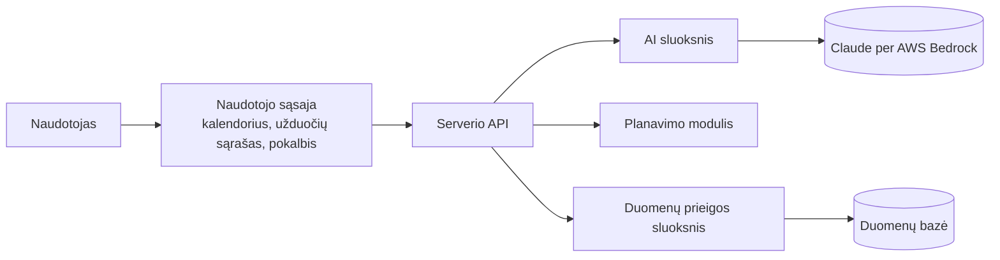

# Planuoklis

Kursinio darbo I dalis: projektavimo dokumentas

## 1. Problema ir idėja

**Sistema vienu sakiniu:** asmeninis savaitės planuotojas, kuriame pagrindinis modulis pagal taisykles išdėsto įpročius ir užduotis tarp darbo, paskaitų ir kitų užsiėmimų, o naudotojas per pokalbį su AI laisvu tekstu kuria užduotis ir praneša apie pasikeitimus.

**Problema ir dabartinis procesas:** naudotojai planuoja laiką kalendoriumi (pvz., „Google Calendar“) ir atskiru užduočių sąrašu (pvz., „Todoist“). Laisvo laiko užduotims jie ieško patys ir kaskart įvertina trukmę, prioritetus, terminus ir kelionės laiką. Toks planavimas užima daug laiko ir kartojamas kas savaitę. Pasikeitus bent vienai aplinkybei (atšaukiama paskaita, užduotis užtrunka ilgiau), planą tenka dėlioti iš naujo, todėl naudotojai dažnai jo atsisako. Be to, apie nespėjamą terminą jie sužino per vėlai.

**Nauda:**

- sistema pati sudaro savaitės planą, o naudotojas jį patvirtina arba atmeta;
- pasikeitus aplinkybėms, sistema perplanuoja savaitę ir kuo mažiau keičia jau suplanuotus blokus;
- jau planuodama sistema parodo, kas netilpo ir kodėl, o AI pasiūlo, ką pakeisti;
- naudotojui pažymėjus, kiek užduoties atliko, likęs darbas perplanuojamas automatiškai;
- užduotį galima aprašyti laisvu tekstu, pvz., „parašyti ataskaitą, apie 3 val., iki penktadienio“.

**Naudotojai:** asmenys, planuojantys savo laiką (pvz., studentai ir dirbantys žmonės). Kiekvienas naudotojas turi atskirą darbo erdvę, kuri sistemoje yra atskiras klientas. Naudotojas nurodo užimtus laikotarpius ir fiksuotus įvykius, įveda užduotis, įpročius ir vietas, prašo suplanuoti savaitę ir patvirtina pasiūlymą. Per savaitę jis praneša apie pasikeitimus, po kiekvieno bloko pažymi, kiek atliko, o atsiradus laisvo laiko klausia, kokią užduotį geriausia atlikti.

**Prielaidos:** iš asmeninės patirties žinoma, kad rankiniu būdu sudarytas planas greitai pasensta. Darome prielaidą, kad:

- naudotojas geba apytiksliai įvertinti užduoties trukmę;
- vietas ir kelionės laiką tarp jų nurodo pats naudotojas, ir šis laikas yra pastovus;
- vienas naudotojas turi vieną darbo erdvę, bendrų kalendorių nėra;
- blokų laikai yra 15 minučių kartotiniai (pvz., 9:00, 9:15, 9:30), o trukmė apvalinama aukštyn (pvz., 50 min. tampa 60 min.);
- visi laikai nurodomi viena laiko juosta.

## 2. Apimtis

| Funkcija | Ką naudotojas galės atlikti | Pagrindinis modulis ar pagalbinė funkcija |
|---|---|---|
| Savaitės planavimas | Paprašo suplanuoti savaitę arba praneša apie pasikeitimą ar laisvą laiką ir gauna plano pasiūlymą su nurodymu, kas netilpo ir kodėl | Pagrindinis modulis |
| Užduočių kūrimas ir valdymas | Sukuria užduotį (pavadinimas, trukmė, terminas, prioritetas, vieta, priėmimo kriterijai) formoje arba per pokalbį. Tvarko įpročius, vietas ir kelionės laiką, užimtus laikotarpius, fiksuotus įvykius ir rezervuotus blokus | Pagalbinė funkcija |
| Pokalbis su AI | Laisvu tekstu aprašo užduotį ar pasikeitimą. AI paruošia duomenis, naudotojas juos patvirtina | Pagalbinė funkcija |
| Atlikimo žymėjimas | Po bloko pažymi, kiek atliko: visą, dalį (procentais) ar nieko. Nepažymėtas blokas laikomas neatliktu. Likęs darbas įtraukiamas į kitą planavimą | Pagalbinė funkcija |
| Prisijungimas | Prisijungia ir patenka į savo darbo erdvę | Pagalbinė funkcija |

**Į kursinio darbo apimtį neįeina:** užduočių dydžio vertinimas taškais (angl. story points) ir mokymasis iš faktinio tempo, praėjusių savaičių analizė, prijungimas prie kitų sistemų (pvz., kito AI asistento), sinchronizavimas su „Google Calendar“ (atidėta vėlesniam laikui) ir atskira mobilioji programėlė (sistema naudojama per telefono naršyklę).

## 3. Pagrindinis modulis

**Pavadinimas ir atsakomybė:** planavimo modulis. Iš vienos darbo erdvės duomenų jis sudaro savaitės plano pasiūlymą: kiekvienam įpročiui ir užduočiai parenka laiką, po pasikeitimų perplanuoja ir praneša, kas netilpo. Modulis deterministinis (ta pati įvestis visada duoda tą patį rezultatą). Jis nepriklauso nuo naudotojo sąsajos, duomenų bazės ir AI, todėl jį galima testuoti atskirai.

**Logika, kurią reikės projektuoti ir testuoti:** modulis deda įpročius ir užduotis prioriteto ir termino tvarka, todėl, kai laiko neužtenka, jį pirmiausia gauna svarbesni ir skubesni. Likus nustatytam dienų skaičiui iki termino, užduoties prioritetas padidėja vienu lygiu. Griežtosios taisyklės nustato, kada bloką galima suplanuoti. Iš tinkamų laikų modulis pasirenka geriausią pagal lanksčius tikslus, kurių tvarką naudotojas gali keisti. Jei įprotis ar užduotis netelpa, modulis nurodo taisyklę, be kurios tinkamas laikas atsirastų. Jei tokios vienos taisyklės nėra, jis nurodo visas taisykles, kurios atmetė laikus. Tos pačios taisyklės taikomos ir parenkant užduotį netikėtai atsiradusiam laisvam laikui.

**Įvestis:** vienos darbo erdvės duomenys vienai savaitei:

- planuojama savaitė ir dabartinis laikas (anksčiau už jį nieko nededama);
- nustatymai: dienos pradžia ir pabaiga, mažiausia bloko trukmė, pertrauka tarp blokų, dienos riba (didžiausia per dieną suplanuojamų užduočių ir įpročių trukmė), paros meto žymės (pvz., „vakaras“ 17:00–22:00), kada didinti prioritetą (pvz., likus 2 dienoms iki termino) ir lanksčių tikslų tvarka;
- vietos su žymėmis (pvz., namai su žyme „kompiuteris“) ir kelionės laikas tarp jų;
- užimti laikotarpiai (darbas, paskaitos), fiksuoti įvykiai (pvz., gimtadienis) ir rezervuoti blokai (pvz., pietūs), kurių tikslų laiką nurodytame lange parenka modulis;
- įpročiai: kiek kartų per savaitę ir kiek jau atlikta, trukmė, prioritetas, leidžiamos vietos, leidžiamas laiko langas ir pageidaujamas paros metas;
- užduotys: likusi trukmė, terminas, prioritetas, ar galima skaidyti, leidžiamos vietos, leidžiamas laiko langas, pageidaujamas paros metas ir priklausomybės;
- jau suplanuoti blokai. Užrakintų blokų modulis nejudina ir juos įskaičiuoja: jie sumažina, kiek kartų įprotį dar reikia suplanuoti, ir likusią užduoties trukmę.

Pavyzdys: savaitė 2026-10-12–10-18, diena 07:00–22:00, mažiausias blokas 45 min., pertrauka 10 min., dienos riba 8 val. Vietos: namai (žymė „kompiuteris“), darbas ir sporto salė; kelionė namai–darbas trunka 30 min., namai–sporto salė 15 min., darbas–sporto salė 20 min. Kiekviena diena prasideda namuose. Darbas pirmadienį–penktadienį 9:00–17:00 darbe. Įprotis „sportas“: 3 kartus per savaitę po 60 min. sporto salėje, vidutinis prioritetas, pageidaujama vakare. Užduotis „parašyti ataskaitą“: 180 min., aukštas prioritetas, terminas penktadienį 23:59, galima skaidyti, atliekama tik vietoje su žyme „kompiuteris“.

**Išvestis:** plano pasiūlymas, kurį sudaro suplanuoti blokai (įprotis ar užduotis, pradžia, pabaiga, vieta, ar blokas užrakintas), netilpę įpročiai ir užduotys (kiek minučių netilpo ir dėl kurių taisyklių) ir įspėjimai (pvz., apie nespėjamą terminą). Jei įvestis netinkama, grąžinama klaida su priežastimi, o plano nėra.

Pavyzdys (ankstesnei įvesčiai, planuojant sekmadienį vakare):

- „parašyti ataskaitą“: pirmadienį 07:00–08:30 ir 17:30–19:00 namuose;
- „sportas“: pirmadienį 19:15–20:15, ketvirtadienį 17:30–18:30 ir sekmadienį 17:00–18:00 sporto salėje;
- netilpusių įpročių ir užduočių nėra, įspėjimų nėra.

**Veikimo eiga:**

1. Patikrina įvestį; jei ji netinkama, grąžina klaidą su priežastimi.
2. Savaitę padalija į 15 minučių intervalus ir pažymi užimtą laiką.
3. Išdėsto rezervuotus blokus jų laiko languose.
4. Surikiuoja įpročius ir užduotis pagal prioritetą ir terminą.
5. Kiekvienam įpročiui ir užduočiai iš eilės atmeta laikus, kurie pažeidžia griežtąsias taisykles, ir iš likusių pasirenka geriausią pagal lanksčius tikslus. Jei tinkamo laiko nėra, įtraukia įprotį ar užduotį į netilpusių sąrašą su priežastimi.
6. Prideda įspėjimą netilpusioms užduotims, kurių terminas patenka į šią savaitę.

**Taisyklės arba sprendimo žingsniai**

Griežtosios taisyklės (blokas, kuris pažeidžia bent vieną, nesuplanuojamas):

| ID | Taisyklė |
|---|---|
| G1 | Blokas telpa tarp dienos pradžios ir pabaigos ir nepersidengia su užimtais laikotarpiais, fiksuotais įvykiais ar kitais blokais |
| G2 | Blokas neprasideda anksčiau už dabartinį laiką |
| G3 | Blokas telpa į įpročio ar užduoties leidžiamą laiko langą |
| G4 | Blokas vyksta leidžiamoje vietoje, turinčioje visas reikalingas žymes |
| G5 | Tarp blokų skirtingose vietose lieka bent tiek laiko, kiek trunka kelionė |
| G6 | Tarp blokų lieka bent nustatyta pertrauka; kelionės laikas įskaičiuojamas į pertrauką |
| G7 | Skaidomos užduoties dalis nėra trumpesnė už mažiausią bloko trukmę, nebent tai visa likusi trukmė |
| G8 | Per dieną suplanuotų užduočių ir įpročių bendra trukmė neviršija dienos ribos |
| G9 | Užduoties blokas baigiasi iki termino |
| G10 | Užduotis prasideda tik pasibaigus užduotims, nuo kurių ji priklauso |
| G11 | Tas pats įprotis per dieną suplanuojamas ne daugiau kaip kartą |

Lankstūs tikslai (numatyta tvarka, kurią naudotojas gali keisti):

| ID | Tikslas |
|---|---|
| L1 | Perplanuojant blokas paliekamas ten, kur buvo |
| L2 | Užduotis, turinti terminą, dedama kuo anksčiau |
| L3 | Blokas patenka į pageidaujamą paros metą |
| L4 | Įpročio blokas dedamas kuo daugiau dienų nuo artimiausio kito to paties įpročio bloko |
| L5 | Blokas vyksta toje pačioje vietoje, kurioje naudotojas buvo prieš jį |

Jei variantai lygiaverčiai, pasirenkamas ankstesnis laikas.

**Scenarijai būsimiems testams**

Bendros sąlygos: planuojamas tik pirmadienis, planavimas paleidžiamas sekmadienį, diena 07:00–22:00, pertrauka 0 min., mažiausias blokas 45 min., dienos ribos nėra, viena vieta (namai).

| Scenarijus | Pradinės sąlygos ir konkreti įvestis | Veiksmas | Tikslus laukiamas rezultatas |
|---|---|---|---|
| Įprastas atvejis | Užimta 09:00–17:00. Užduotis „ataskaita“: 120 min., aukštas prioritetas, terminas pirmadienį 23:59 | Paleidžiamas planavimas | „Ataskaita“ suplanuota pirmadienį 07:00–09:00 |
| Konfliktas (perkrauta diena) | Laisva tik 07:00–08:00 ir 17:00–18:00. Užduotys A (aukštas prioritetas), B ir C (žemas), po 60 min., neskaidomos, be terminų | Paleidžiamas planavimas | A 07:00–08:00, B 17:00–18:00 (B pirmiau už C pagal ID), C netilpo dėl G1 (nėra laisvo laiko). Dalinis planas grąžinamas kaip pasiūlymas |
| Neįmanomas rezultatas | Visa diena laisva. Užduotis: 180 min., neskaidoma, terminas pirmadienį 09:00 | Paleidžiamas planavimas | Užduotis netilpo dėl G9 (anksčiausia pabaiga 10:00, po termino), pridėtas įspėjimas „terminas nebus įvykdytas“ |
| Klaida | Užduotis A priklauso nuo B, o B nuo A | Paleidžiamas planavimas | Grąžinama įvesties klaida „ciklinė priklausomybė“, plano nėra |

**Jei modulis naudoja AI:** netaikoma. Pats modulis AI nenaudoja; AI vaidmuo sistemoje aprašytas 6 skyriuje.

## 4. Kokybės atributas

**Pasirinktas atributas:** palaikomumas. Naują planavimo taisyklę turi būti galima pridėti nekeičiant esamų.

**Kodėl svarbus šiai sistemai:** taisyklių ir pageidavimų daugės. Jei dėl kiekvienos naujos taisyklės tektų keisti veikiantį kodą, būtų lengva netyčia sugadinti esamas taisykles.

**Tikrinimo scenarijus ir sąlygos:** pridedama nauja taisyklė „užduotys nededamos po 21:00“ (valanda nurodoma nustatymuose). Atskirai nustatymuose pakeičiama lanksčių tikslų tvarka.

**Sėkmės kriterijus:** naujai taisyklei pakanka parašyti vieną naują klasę su testais ir įtraukti ją į taisyklių sąrašą. Kitos taisyklės ir pagrindinis planavimo kodas nesikeičia, ir tai matyti pakeitimų sąraše („git diff“). Visi ankstesni testai praeina. Pakeitus tikslų tvarką, planas pasikeičia be kodo pakeitimų.

**Numatytas projektavimo sprendimas:** kiekviena taisyklė yra atskira klasė su tuo pačiu metodu: jis gauna tikrinamą laiką ir iki tol sudarytą planą, o grąžina atsakymą „tinka“ arba „netinka“ su taisyklės ID. Pagrindinis kodas turi taisyklių sąrašą ir konkrečių taisyklių nežino, todėl naują taisyklę galima įtraukti jo nekeičiant.

**Kaip patikrinsiu vėlesniame etape:** III etape gyvai pridėsiu naują taisyklę ir paleisiu visus testus.

**Sprendimo kaina arba ribojimas:** kodas sudėtingesnis, nei jei visos sąlygos būtų tikrinamos vienoje vietoje. Be to, kiekvienai taisyklei perduodamas visas planas, nors daliai taisyklių jo nereikia.

## 5. Pradinė sistemos struktūra

**Paprasta schema:**

| Sistemos dalis | Atsakomybė |
|---|---|
| Naudotojo sąsaja | Rodo kalendorių, užduočių sąrašą, pokalbį ir plano pasiūlymą, kurį naudotojas patvirtina arba atmeta |
| Serverio API | Pagal prisijungusį naudotoją nustato darbo erdvę, paruošia planavimo modulio įvestį ir išsaugo patvirtintą planą |
| Planavimo modulis | Sudaro plano pasiūlymą (3 skyrius). Į duomenų bazę ir AI nesikreipia |
| AI sluoksnis | Kreipiasi į Claude per AWS Bedrock ir tikrina, ar atsakymas atitinka nustatytą duomenų formatą (schemą). Apie netinkamą atsakymą ar klaidą praneša naudotojui |
| Duomenų prieigos sluoksnis | Skaito ir rašo duomenis. Kiekviena užklausa apribojama viena darbo erdve, todėl klientas negali pasiekti kito kliento duomenų |
| Duomenų bazė | Saugo darbo erdves, užduotis, įpročius, vietas, nustatymus ir patvirtintus planus. Kiekviena su darbo erdve susijusi lentelė turi darbo erdvės ID |

**Planuojamos technologijos ir pasirinkimo priežastys:**

- TypeScript (Node.js) serveryje ir naršyklėje: visai sistemai užtenka vienos kalbos, o tipai padeda tikrinti duomenis, ypač AI atsakymus.
- Fastify serveriui: paprasta Node.js biblioteka užklausoms priimti. Vėliau programą galima perkelti į AWS Lambda nekeičiant planavimo kodo.
- React ir Vite naudotojo sąsajai: ši sąranka jau naudojama kitame mano projekte.
- SQLite: duomenys saugomi viename faile, atskiro duomenų bazės serverio nereikia, todėl prototipas pasileidžia viena komanda.
- Claude per AWS Bedrock: kodas, kuris kreipiasi į Bedrock, jau veikia kitame mano projekte.
- Vitest testams: veikia su TypeScript ir Vite be papildomos konfigūracijos.

## 6. AI panaudojimas

**AI rengiant šį dokumentą:** naudojau Claude (Anthropic) pokalbių sesijose.

| Priemonė ir užduotis | Ką panaudojau | Ką atmečiau arba perrašiau ir kodėl | Kaip patikrinau |
|---|---|---|---|
| Claude: planavimo algoritmo projektavimas | Godųjį algoritmą (įpročiai ir užduotys dedami po vieną į geriausią tinkamą laiką), taisyklių skirstymą į griežtąsias ir lanksčias, įvesties ir išvesties struktūrą | Pakeičiau modulio elgesį, kai savaitė perkrauta: jis tik nurodo, kas netilpo, o sprendžia naudotojas. Pataisiau scenarijų, kuriame būtų nurodyta ne ta taisyklė | Scenarijų rezultatus apskaičiavau ranka |
| Claude: dokumento teksto rengimas | Pirminius skyrių juodraščius | Perrašiau neaiškius ir nelietuviškai skambančius sakinius, pašalinau perteklinius teiginius | Palikau tik teiginius, kuriuos galiu paaiškinti |

**Planuojamas AI naudojimas kuriant sistemą**

**Kur ir kam naudosiu AI:** kodą rašysiu su Claude Code (projekto struktūrą, taisykles, testus ir naudotojo sąsają).

**Kaip tikrinsiu pasiūlymus ir sugeneruotą kodą:** AI gali parašyti kodą, kuris praeina testus, bet neatitinka taisyklės prasmės. Todėl testų laukiamus rezultatus apskaičiuosiu ir surašysiu pats (3 skyriaus scenarijai). Kodą peržiūrėsiu prieš įkeldamas ir priimsiu tik tokį, kurį galiu paaiškinti.

**Ar AI bus sistemos funkcionalumo dalis:** taip. AI iš naudotojo teksto paruošia užduotis ir kitus duomenis, o kai kas nors netelpa, pasiūlo, ką pakeisti (pvz., sportuoti 2 kartus per savaitę vietoj 3). AI atsakymas tikrinamas pagal schemą, o į duomenų bazę patenka tik naudotojo patvirtinti pakeitimai. Blokų laiko ir datų AI neskaičiuoja: blokus išdėsto planavimo modulis, o išraišką, pvz., „iki penktadienio“, į datą paverčia datų įrankis, kurį AI iškviečia.

## 7. Tolesnių darbų planas

| Darbas | Apčiuopiamas rezultatas | Planuojama darbų seka |
|---|---|---|
| Planavimo modulis | Taisyklės G1–G4, G6–G9 ir G11, eiliškumas ir įvesties tikrinimas; praeina 3 skyriaus scenarijų testai | 1 |
| Duomenų bazė, prisijungimas ir API | SQLite lentelės su darbo erdvės ID, du iš anksto sukurti naudotojai, plano išsaugojimas; klientų duomenų atskyrimo testas | 2 |
| Naudotojo sąsaja | Kalendorius su plano pasiūlymu, jo patvirtinimu ir atmetimu; užduočių sąrašas ir forma | 3 |
| AI pokalbis | Užduoties kūrimas iš teksto per Claude, atsakymo tikrinimas pagal schemą, pasiūlymai, ką pakeisti | 4 |
| Paleidimas ir README | Paleidimas viena komanda; README su instrukcija ir pavyzdiniais duomenimis | 5 |

**Būsimo prototipo veikimo scenarijus:** naudotojas prisijungia prie darbo erdvės, kurioje yra darbas pirmadienį–penktadienį 9:00–17:00 ir įprotis „sportas“ 3 kartus per savaitę. Pokalbyje jis parašo „parašyti ataskaitą, apie 3 val., iki penktadienio, svarbu“, patvirtina AI paruoštą užduotį ir paprašo suplanuoti savaitę. Sistema parodo plano pasiūlymą, naudotojas jį patvirtina, ir planas išsaugomas. Prisijungus kitu naudotoju, šie duomenys nematomi.

| Rizika arba neaiškumas | Kaip patikrinsiu arba sumažinsiu |
|---|---|
| Neaišku, ar visas taisykles pavyks tikrinti vienodu būdu (4 skyrius). Sudėtingiausios yra taisyklės, kurioms reikia viso dienos plano (G8, G11). | Šias taisykles įgyvendinsiu pirmas. Jei vienodas būdas joms netiks, jį pakeisiu, kol taisyklių dar nedaug. |
| Perplanuojant jau suplanuoti blokai turėtų likti savo vietose (L1). Tačiau nauja svarbesnė užduotis dedama pirma ir gali užimti jų laiką. Tada vienas pakeitimas perkelia daug blokų. | Testu patikrinsiu, kiek blokų persikelia pridėjus vieną užduotį. Jei per daug, perplanuojant pirmiausia bus dedami jau suplanuoti blokai. |
| Nauja taisyklė dažnai turi savo nustatymą (pvz., „ne po 21:00“). Jei kiekvienas nustatymas bus atskiras duomenų bazės laukas, naujai taisyklei teks keisti duomenų bazę, ir 4 skyriaus kriterijus nebus įvykdytas. | Kiekviena taisyklė turės savo nustatymus su numatytomis reikšmėmis, o duomenų bazė juos visus saugos viename lauke. Tai patikrinsiu III etape, pridėdamas 4 skyriaus taisyklę. |

**Šaltiniai:** idėja ir sprendimai grįsti asmenine patirtimi planuojant savaitę. Kitų šaltinių nenaudojau.
